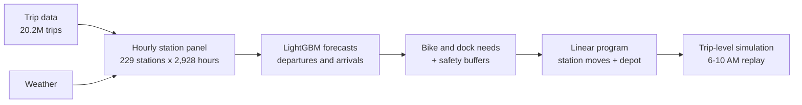

# Citi Bike Demand Forecasting and Overnight Rebalancing

An end-to-end forecast-and-optimize pipeline for bike-share rebalancing in Midtown Manhattan. Station-level demand forecasts from LightGBM feed a linear program that sets each station's starting inventory before the morning rush, and every plan is evaluated by replaying 20 million real trips.

**Result:** on held-out September 2025 weekdays, the forecast-driven plan cut simulated morning failures (no bike to rent, no dock to return) by **59%** and lowered total operating cost by **14%** vs. a rule-based heuristic, while moving **34% fewer bikes**.

## Business problem

Every weekday morning, commuters ride from residential neighborhoods into Midtown. Stations in Hell's Kitchen and along the East River run out of bikes, while stations around Grand Central and Penn Station fill up and riders cannot return their bikes. Operators reposition bikes overnight with trucks, but trucks and crews are limited.

The question: **given tomorrow's forecast demand, how many bikes should each station hold at 6 AM, and which moves get there at the lowest cost?**

## Data

| Source | Coverage | Use |
|---|---|---|
| [Citi Bike System Data](https://citibikenyc.com/system-data) | June–September 2025, 20.2M trips | Demand, net flows and simulation |
| [Citi Bike GBFS](https://gbfs.citibikenyc.com/gbfs/en/station_information.json) station feed | Snapshot taken Nov 1, 2026 | Station capacity |
| [Open-Meteo](https://open-meteo.com/) historical weather | Hourly, Midtown Manhattan | Temperature and precipitation features |

**Study area:** 229 stations between 14th and 59th Street (6.2M departures). Midtown alone is almost entirely office stations; extending south to 14th Street adds residential areas, so the area contains both stations that lose bikes and stations that gain them in the morning.

## Approach



1. **Ingest and clean** (`00`): convert monthly CSVs to Parquet with DuckDB, remove trips under 1 minute or over 3 hours (0.16%), and match stations to GBFS capacity (14 stations imputed with the area median).
2. **Demand patterns** (`01`): build a zero-filled hourly panel and study weekday vs. weekend flows, station types, weather and holidays.
3. **Forecasting** (`02`): LightGBM with a Poisson objective forecasts hourly departures and arrivals per station from lagged same-hour history, calendar and weather features. Forecasts are made at midnight for the next day, so every lag uses the previous day or earlier.
4. **Optimization and simulation** (`03`): for each test weekday, a linear program chooses starting inventories and station-to-station moves (within 2 km), with an external depot for bikes the area cannot absorb. Each plan is replayed against the actual trips of the next morning in time order.

### Optimization model

Minimize `penalty × expected shortfalls + cost per bike-km × moves + depot cost × depot trips`, subject to inventory balance and station capacity. Each station's target range is

```
need_bikes + k_bikes × σ  ≤  starting inventory  ≤  capacity − need_docks − k_docks × σ
```

where `need_bikes` and `need_docks` come from the forecast cumulative net flow between 6 and 10 AM, and `σ = √(forecast departures + arrivals)` is the Poisson standard deviation. The buffers `k_bikes` and `k_docks` are tuned on a separate validation week. The model is solved with SciPy's HiGHS LP solver.

## Key findings

### Demand patterns
- The area runs a commuter cycle: on weekdays it gains about 2,500 bikes by noon and loses them in the 4–7 PM peak, when departures reach 6,400 per hour.
- It loses about **1,000 bikes per day** on every day type (weekends included), so the operator must resupply it daily. This motivates the depot in the model.
- Rain cuts demand by 21% on weekdays and 39% on weekends; temperature matters only above 33 °C.
- Station-hour counts are overdispersed (variance 12× the mean, 17.5% zeros), which favors a Poisson objective.

### Forecasting (test period: Sep 15–30, 2025)

| Method | Departures MAE (trips/station-hour) | Hourly WAPE | 7–10 AM net-flow MAE (bikes/station-day) |
|---|---|---|---|
| Seasonal naive (same hour last week) | 4.25 | 41.2% | 11.5 |
| Historical average | 3.72 | 36.1% | 11.0 |
| **LightGBM (Poisson)** | **3.36** | **32.6%** | **9.6** |

LightGBM reduces the morning net-flow error, the quantity the optimization uses, by 13% vs. the historical average.

### Rebalancing (12 test weekdays, 6–10 AM)

| Strategy | Failures / day | vs. no rebalancing | Bikes moved | Depot trips | Total cost |
|---|---|---|---|---|---|
| No rebalancing | 2,551 | — | 0 | 0 | 25,512 |
| Rule-based (fill outflow stations to 90%, empty inflow stations to 10%) | 1,007 | −60.5% | 2,887 | 1,166 | 14,861 |
| LightGBM, no buffer | 1,822 | −28.6% | 1,008 | 0 | 18,621 |
| LightGBM, symmetric buffer | 1,406 | −44.9% | 1,319 | 0 | 14,769 |
| **LightGBM, asymmetric buffer** | **1,057** | **−58.6%** | **1,913** | **394** | **12,813** |
| Perfect forecast (benchmark) | 843 | −67.0% | 1,562 | 0 | 9,142 |

- **Planning to the forecast mean is not enough.** The first forecast-driven plan lost to the simple rule because it left no room for random variation and LightGBM under-predicts the sharpest peaks.
- **Safety buffers fix most of the gap.** 74% of failures are returns to full stations, so the tuned dock buffer (`k_docks = 2.0`) is four times the bike buffer (`k_bikes = 0.5`). The selected buffers gave a validation cost of 12,407 and a test cost of 12,813, so they carry over to unseen days.
- **Final result:** the asymmetric-buffer plan matches the rule's failure reduction (58.6% vs. 60.5%) at 14% lower total cost, with 34% fewer bikes moved, 18% fewer bike-km and 66% fewer depot trips.
- **Better forecasts are the main remaining lever.** A perfect forecast would cut total cost a further 29%, mostly by capturing morning peaks more accurately.

## Limitations

- **Starting inventory is assumed.** Overnight station inventory is not public, so every station is assumed to start the night at 50% of capacity.
- **Observed demand is censored.** Trips that riders could not take because a station was empty are not in the data, so true demand at busy stations is understated.
- **The simulation is approximate.** Failed trips are not re-routed to nearby stations, and their downstream arrivals still occur.
- **Weather is observed, not forecast.** A production system would use weather forecasts, which are less accurate.
- **Capacity comes from a 2026 snapshot.** 14 stations (5% of departures) use an imputed median capacity.
- **One overnight move per day.** About 10 stations a day need more bikes and docks than their capacity allows; only intraday rebalancing or valet service can serve them. Truck routing is not modeled.

## Next steps

- Replace Poisson buffers with LightGBM quantile forecasts of the morning peak.
- Add intraday rebalancing and a vehicle-routing layer for truck capacity and travel time.
- Run a capacity sensitivity analysis for the 14 imputed stations.
- Correct for censored demand at stations that frequently run empty or full.

## Repository structure

```
citibike-rebalancing/
├── data/
│   ├── raw/          # monthly trip CSVs (not committed)
│   ├── processed/    # Parquet outputs of each notebook (not committed)
│   └── external/     # GBFS station snapshot, Open-Meteo weather
├── notebooks/
│   ├── 00_data_ingest.ipynb       # load, clean, define study area and capacities
│   ├── 01_demand_patterns.ipynb   # hourly panel, flows, weather and holiday effects
│   ├── 02_forecasting.ipynb       # baselines vs. LightGBM
│   └── 03_optimization.ipynb      # LP, safety buffers, trip-level simulation
└── README.md
```

## Reproduce

1. Create the environment:
   ```bash
   conda install -n ds duckdb pandas numpy matplotlib lightgbm scipy
   ```
2. Download June–September 2025 trip data into `data/raw/`:
   ```bash
   cd data/raw
   for m in 202506 202507 202508 202509; do
     curl -fO https://s3.amazonaws.com/tripdata/${m}-citibike-tripdata.zip && \
     unzip -q ${m}-citibike-tripdata.zip -d ${m} && \
     rm ${m}-citibike-tripdata.zip
   done
   ```
3. Run the notebooks in order, `00` to `03`. The GBFS snapshot and weather file are already in `data/external/`.

## Tech stack

Python, DuckDB, pandas, LightGBM, SciPy (HiGHS), matplotlib
